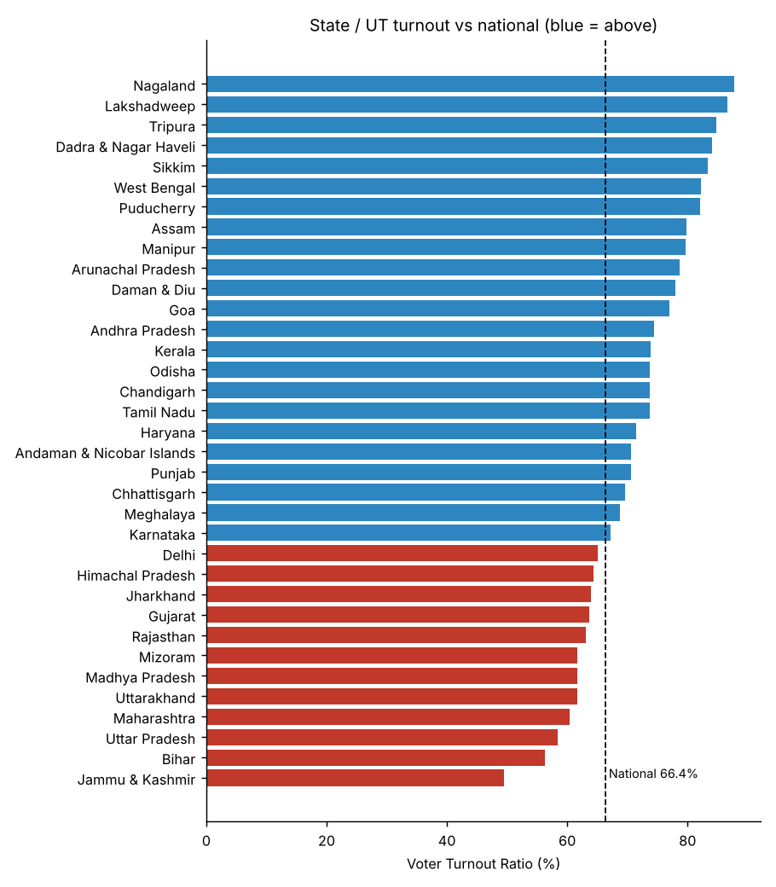
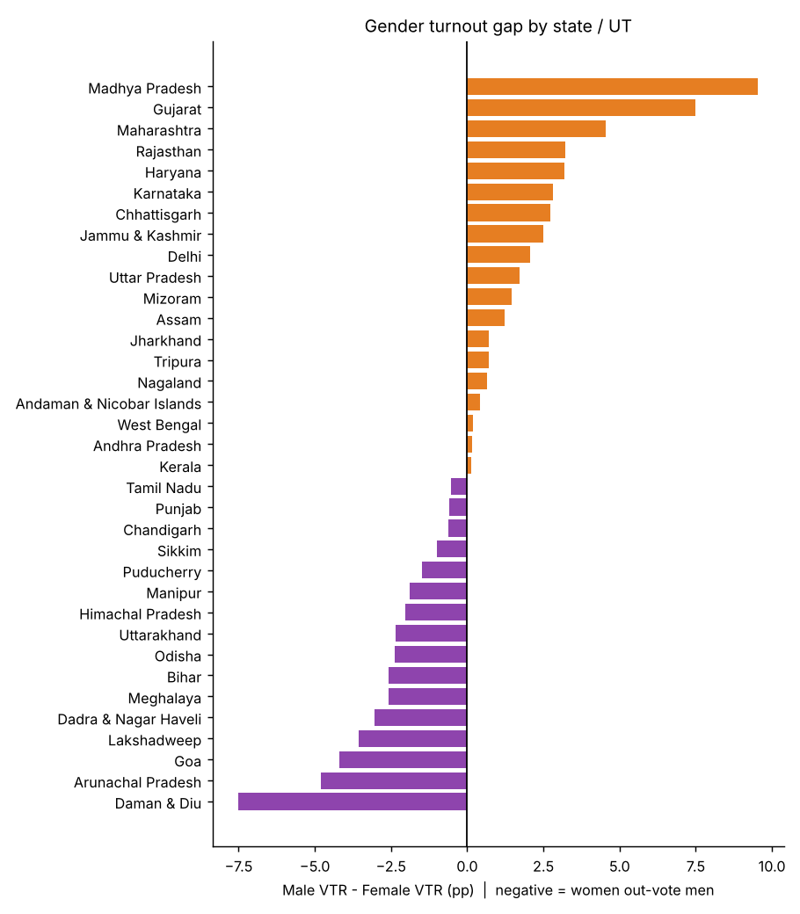

# Voter Turnout Analysis - Indian Lok Sabha Elections

Data analysis of constituency-wise (543 PCs) and state-wise voter turnout, split by gender.
Pipeline: clean -> compute KPIs -> charts. Pure Python (pandas, matplotlib).

> Dataset note: totals (83.41 crore electors, 66.40% VTR, 42 PCs in Andhra Pradesh) match the **2014** general election.

## Headline results
| KPI | Value |
|---|---|
| Overall VTR | 66.40% |
| Male / Female VTR | 67.09% / 65.63% |
| Elector gender ratio | 908 F per 1,000 M |
| PCs where women out-voted men | 165 / 543 |
| PCs below 60% turnout | 27.8% |
| Highest / lowest state | Nagaland 87.8% / Jammu & Kashmir 49.5% |




Full findings: [docs/INSIGHTS.md](docs/INSIGHTS.md) | KPI definitions: [docs/KPI_CATALOG.md](docs/KPI_CATALOG.md)

## Project structure
```
data/raw/          original CSVs (pc-wise, state-wise)
data/processed/    cleaned numeric CSVs
src/clean.py       parse Indian number format, fix names, validate
src/kpis.py        compute KPIs, write outputs/tables/*.csv
src/charts.py      write outputs/charts/*.png
run_all.py         runs everything
docs/              KPI catalog and insights
```

## How to run
```bash
git clone <your-repo-url> && cd voter-turnout-india-2024
python -m venv .venv && source .venv/bin/activate   # Windows: .venv\Scripts\activate
pip install -r requirements.txt
python run_all.py
```

## Validation performed
- Male + female electors = total electors for all 543 PCs.
- Recomputed turnout matches reported turnout within 0.005 pp.
- PC totals sum exactly to the state file.

## Limitations
No postal/EVM split, booth-level, age, margin or previous-election data, so those KPIs are documented but not computed (see KPI catalog, section B).

## License
MIT
